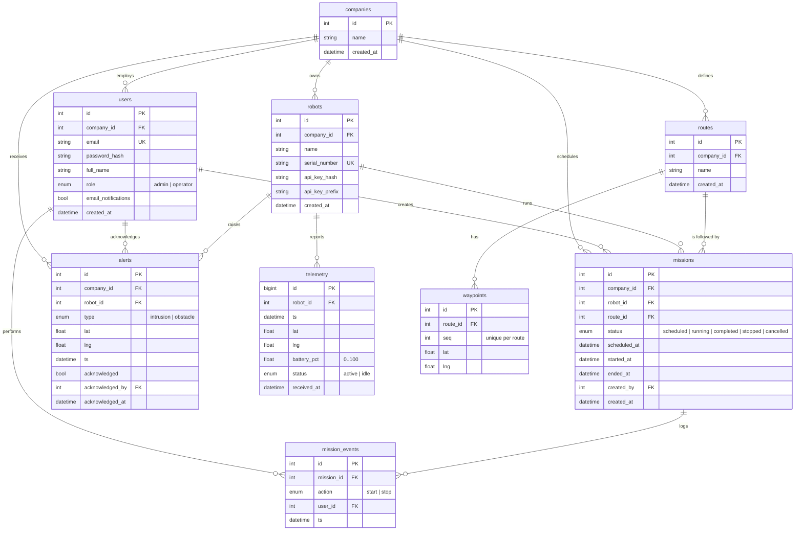

# Data model

Fleet Control keeps one tenant boundary: every user, robot, route, mission, and
alert belongs to a `companies` row, and every query filters on the signed-in
user's `company_id`. Timestamps are stored in UTC and displayed in the
browser's local time.

This build uses SQLAlchemy models as the source of truth and creates the schema
with `Base.metadata.create_all` at startup (see `backend/app/db/init_db.py`).
There is no Alembic history in the adapted SQLite build; the models and this
document move together.



## Mission state transitions

```
scheduled ──start──> running ──stop──> stopped
    │                   │
    │                   └──(auto-complete is a future improvement)
    └──cancel──> cancelled
```

- `start` is allowed only from `scheduled`, and only if the robot has no other
  running mission (`409`).
- `stop` is allowed only from `running` (`409` otherwise).
- Nothing leaves `completed`, `stopped`, or `cancelled`.
- Every successful `start`/`stop` appends a `mission_events` row with the user
  and the UTC timestamp.

## Indexes and constraints

| Table | Index / constraint | Purpose |
|---|---|---|
| `users` | unique `email` | login lookup and identity |
| `robots` | unique `serial_number`, `company_id` index | duplicate check, tenant scoping |
| `telemetry` | `(robot_id, ts)` index, check `0 <= battery_pct <= 100` | latest sample and history reads |
| `waypoints` | unique `(route_id, seq)` | stable route order |
| `missions` | check on `status`, `company_id` / `robot_id` indexes | valid states and scoping |
| `mission_events` | check on `action`, `mission_id` index | traceability |
| `alerts` | `(company_id, acknowledged, ts)` index | open queue and dashboard count |

## Performance

- `get_latest_for_company` uses a window function (`ROW_NUMBER() OVER PARTITION
  BY robot_id ORDER BY ts DESC`) instead of PostgreSQL-only `DISTINCT ON`, so
  the same query works on SQLite and PostgreSQL.
- `missions_per_day` groups by the date of `ended_at` and zero-fills the seven
  days in Python, so an empty day still appears in the response.
- `battery_history` and `uptime_pct` read the indexed `(robot_id, ts)` range and
  bucket in Python, because SQLite has no `date_bin`. This is comfortable at
  demo scale; on PostgreSQL the bucketing belongs in SQL.
- The demo seed (`backend/scripts/seed_demo_data.py`) writes seven days of
  telemetry at one sample per 10 seconds for five robots (about 300k rows) in
  bulk, and the analytics tests cover the query contracts.
