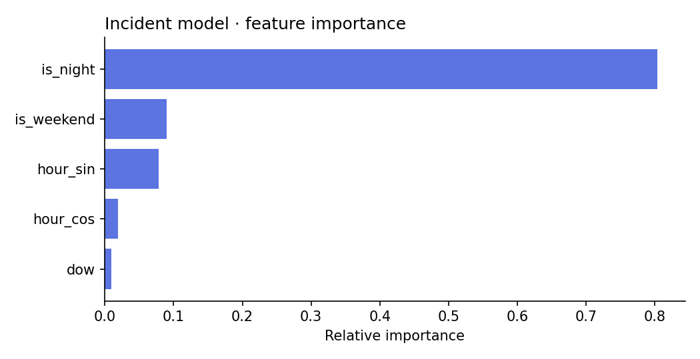

# Incident prediction model

## What this predicts

Whether at least one intrusion or obstacle alert occurs in a given hour. The
app asks the model for the next 24 hours, so it may only use features known in
advance: the hour of day, the day of week, and whether the hour falls at night
or on a weekend.

> **Synthetic data caveat.** Real alert history in this practice build is tiny
> (18 alerts at the time of training). Training therefore combines those alerts
> with 180 days of seeded synthetic incidents. The synthetic rows are fabricated,
> so the numbers below demonstrate the method and the pipeline, not real-world
> predictive skill.

## Dataset

Built by the `ml/` pipeline:

| Step | Script | Output |
|---|---|---|
| 1. Export real alerts | `export_incidents.py` | `data/raw_incidents.csv` (18 rows) |
| 2. Generate synthetic history | `generate_fake_incidents.py --days 180 --seed 42` | `data/fake_incidents.csv` (764 rows) |
| 3. Clean and de-duplicate | `clean.py` | `data/cleaned_incidents.csv` (782 rows) |
| 4. Complete hourly grid | `build_dataset.py` | `data/hourly_dataset.csv` (4,314 rows) |

The hourly grid runs from **2026-05-18 22:00 UTC** to **2026-11-14 15:00 UTC**
with no gaps; 651 hours contain at least one incident. Cleaning removed no rows
in this run, but the rules are exercised by tests: missing or invalid timestamps,
unknown types, out-of-range coordinates, and duplicate reports from the same
robot and type within one second are dropped.

## Features

| Feature | Definition |
|---|---|
| `hour_sin`, `hour_cos` | cyclic encoding of the hour (0–23) |
| `dow` | day of week, 0 = Monday |
| `is_weekend` | 1 when `dow >= 5` |
| `is_night` | 1 when the hour is 22:00–05:59 |

No recent-history, zone, weather, or robot-specific feature is used, because
those are unknown for the next 24 hours and would leak the future.

## Split

Rows are ordered by time and split **80 / 20**: the first 3,451 hours train,
the last 863 hours test. Nothing is shuffled. The decision threshold is tuned on
a validation slice taken from the end of the training window (the last 20% of
train), never on the test set.

| Window | From | To |
|---|---|---|
| Train | 2026-05-18 22:00 UTC | 2026-10-09 16:00 UTC |
| Test | 2026-10-09 17:00 UTC | 2026-11-14 15:00 UTC |

The training incident rate is 14.4%, so incidents are uncommon but not rare.
Accuracy alone is still misleading: a constant "no incident" prediction would be
85% accurate and useless.

## Results (test window)

| Model | Threshold | Accuracy | ROC-AUC | PR-AUC | F1 | Brier |
|---|---:|---:|---:|---:|---:|---:|
| Baseline A · training rate | 0.50 | 0.8216 | 0.5000 | 0.1784 | 0.0000 | 0.1478 |
| Baseline B · (day, hour) rate | 0.50 | 0.8100 | 0.7089 | 0.3147 | 0.0682 | 0.1362 |
| **Logistic regression** | **0.33** | 0.7358 | **0.7301** | **0.3442** | **0.4842** | 0.1901 |
| Random forest (200 trees) | 0.63 | 0.7532 | 0.7033 | 0.3126 | 0.4496 | 0.1957 |

The logistic regression is chosen because it has the best PR-AUC, narrowly
ahead of the (day, hour) baseline, and a much better F1 (0.484 vs 0.068). Its
lower accuracy and higher Brier score are the cost of predicting the rare
positive class; accuracy is the wrong headline metric here.

## Feature importance

Relative importance from the fitted logistic regression coefficients:

| Feature | Relative importance |
|---|---:|
| `is_night` | 0.804 |
| `is_weekend` | 0.090 |
| `hour_sin` | 0.079 |
| `hour_cos` | 0.019 |
| `dow` | 0.010 |



Night hours dominate, which matches the synthetic rate (0.4 incidents/hour at
night versus 0.05 by day) and is the behaviour an operator would expect.

## In the app

`ml/models/incident_model.joblib` and `ml/models/metrics.json` are loaded by
`backend/app/services/prediction.py`. The service rebuilds the same five
features in the same order for each of the next N hours, calls `predict_proba`,
and caches the result for 60 minutes. Levels are `high` at or above the saved
threshold (0.33), `medium` at or above 70% of it, otherwise `low`.

## Reproduce

```bash
cd ml
python export_incidents.py
python generate_fake_incidents.py --days 180 --seed 42
python clean.py
python build_dataset.py
python train.py
```

## Limitations

- Synthetic incidents are generated from a hand-set night/weekend rate, so the
  model largely learns that generator. Real deployment needs real history.
- Calendar-only features cannot distinguish a quiet Tuesday from a protest.
- No zone/geography, weather, staffing, or robot-health features.
- The dataset timeline is ~180 days; seasonal effects are not represented.
- Thresholds tuned on a small validation slice will move as more real data lands.
